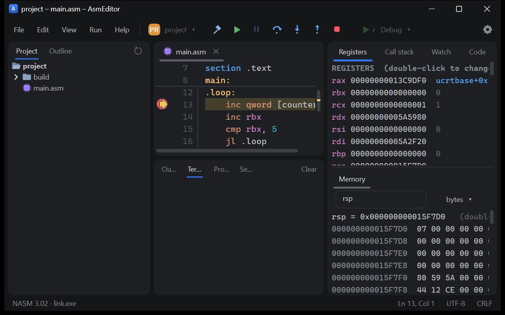
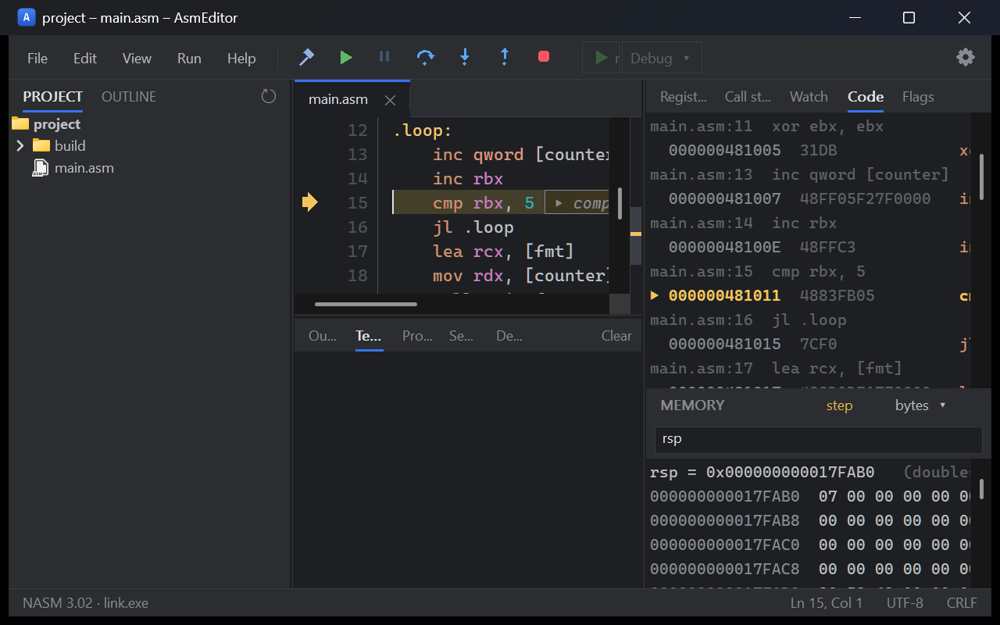
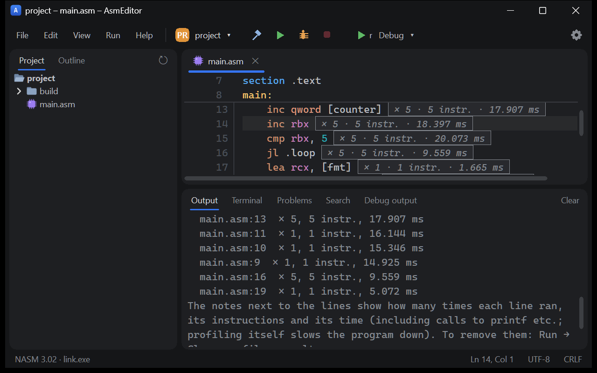

<div align="center">


# AsmEditor

**A lightweight NASM editor and debugger for Windows, built for learning assembly.**

Write x86‑64 assembly, build it with one key, and step through it while watching registers, flags, the stack and memory change.

[](https://github.com/Anready/AsmEditor/actions/workflows/build.yml)
[](https://github.com/Anready/AsmEditor/releases/latest)

-8A63D2)

**English** · [Русский](README.ru.md)

</div>

> [!NOTE]
> **This project was written by an AI.** The code, tests, build scripts, installer and documentation were written by
> Claude, an AI model made by Anthropic, working in Claude Code. A person, [Anready](https://github.com/Anready),
> directed the work: chose what to build, made the decisions and tested the builds.
> See [How this project was made](#how-this-project-was-made).

<p align="center">
  
</p>

## Download

Get the latest version from [**Releases**](https://github.com/Anready/AsmEditor/releases/latest):

| File | What it is |
|---|---|
| `AsmEditor-setup-<version>.exe` | Installer (Start menu shortcut, `.asm` file association) |
| `AsmEditor-portable.zip` | Portable copy — unzip and run; settings stay next to the exe |
| `AsmEditor.exe` | The editor alone |

You also need **[NASM](https://www.nasm.us/)** and a linker: **Visual Studio** (or Build Tools) with the C++
workload, or MinGW `gcc`. AsmEditor finds them on first start; you can change the paths in Settings (Ctrl+Alt+S).

AsmEditor checks for a new release once a day and can update itself (Help → Update AsmEditor). Downloads are
verified against the SHA‑256 digest GitHub publishes.

## Features

### Editor
- NASM syntax highlighting, code folding, multiple cursors, split view, themes (Dark, Light, Monokai, Solarized).
- Context-aware autocompletion: instructions, registers, and the labels and macros of the whole project.
- Hover help for every instruction, register and directive (x87, SSE–SSE4.2, AVX/AVX2, FMA, BMI…), with examples
  for the common ones. Hover over `printf` or `WriteFile` to see the prototype and which registers take the arguments.
- Go to definition, find usages, rename, file outline, find in files, command palette, go to file.
- Code formatting into columns (mnemonics, operands, comments), optional format on save.
- Code snippets: a function with a prologue, loops, `printf`/`scanf`, `WriteFile`, a whole program.

### Catches beginner mistakes
- Errors as you type (NASM runs in the background).
- Warns when the stack is probably not aligned to 16 bytes or has no shadow space before a Win64 `call`.
- Static checks: a callee-saved register (rbx, rbp, rsi, rdi, r12–r15) changed and not restored, `div` without
  preparing `rdx`, unreachable code, reading rcx/rdx/r8–r11 after a call that may have clobbered them.
- **Quick fixes** (Alt+Enter): add `extern printf`, align the stack, save a register, insert `cqo` before `idiv`.
- Typing `call printf` shows which of rcx, rdx, r8, r9 are already set above and which you forgot.

### Build and run
- Build (Ctrl+F9) and run (Ctrl+F5) with NASM + MSVC `link` or `gcc`; multi-file projects with incremental,
  parallel builds and `%include` dependencies.
- Debug and Release profiles, a run configuration (arguments, working folder, environment, stdin file),
  exe / dll / lib output, pre- and post-build commands.
- A real terminal for the program (ConPTY, input, ANSI colors), plus Output, Problems and Debug output panels.
- After the program exits: the exit code explained, run time and peak memory.
- **Linux through WSL**: `elf64`/`elf32` builds, run in a terminal and debug with gdb in the same panels.

### Debugger
Built on the Win32 Debug API; works with 64‑bit and 32‑bit (WOW64) programs.

- Breakpoints with conditions (`rcx == 5`, `[counter] > 3`, `#10` for the 10th hit) and **logpoints**
  (`log: rbx = {rbx}`) that print without stopping.
- Step over / into / out, run to cursor, set next statement, pause, **attach to a running process**.
- **Step back** (Ctrl+Shift+F11): returns to the previous stop and restores registers, globals, the stack and the heap.
- Registers (double-click to edit), call stack (unwinds through DLLs with `.pdata`), watch expressions, memory as
  bytes / words / floats / text with changed bytes highlighted, structs from `struc … endstruc`.
- **Data breakpoints** (DR0–DR3): stop right after something writes to a variable.
- **Flags tab**: every flag explained, all 16 conditions, and on a `jcc`/`cmovcc`/`setcc` whether it will be taken and why.
- **Explains the current line** with real values: `rax = 5 + 3 → 8`, `jl: SF ≠ OF (SF=1 OF=0) → jumps to .loop`.
- Stack animation: changed stack cells light up and fade; `push`, `pop`, `call` and `ret` are explained.
- **Built-in disassembler** (the Code tab): integer, SSE/SSE2, x87, AVX/AVX2/FMA — with source lines above
  each group, so you see what your macros expanded into.

<p align="center">
  
  
</p>

### Profilers
- **Tracing profiler**: how many times each line ran, how many instructions and how much time, shown right next to
  the lines. Calls into `printf` and other code without sources run at full speed.
- **Sampling profiler**: samples every 1 ms; fast, good for longer programs.

### Learning
- **9 lessons**: registers, jumps, loops, division, bit operations, arrays, strings, the stack and recursion, files.
  Each starts with an explanation and ends with a task that checks itself.
- **13 exercises** with tests (Ctrl+Shift+T), requirements (must use an instruction, must be recursive),
  limits on the number of executed instructions, and hints that get more specific (Ctrl+Shift+H).
- **For teachers**: load your own tasks from a text file, collect students' results as CSV and merge a class into
  one student × task table.

  ```ini
  [task sum3]
  title = Sum of three numbers
  description = Read three numbers and print their sum.
  format = %lld %lld %lld
  test = 1 2 3 => 6
  test = -5 5 10 => 10
  must = add
  max-instructions = 100
  hint = Add a, b and c in rdx.
  ```
- New project from a template: Hello world, scanf/printf, pure WinAPI, files, SSE.

### Everything else
- English and Russian interface (including the instruction reference).
- Custom keyboard shortcuts, F1 help with all commands and their current keys.
- Crash recovery for unsaved text, reload on external change, optional autosave.
- Portable mode: put `portable.txt` next to the exe.

## Building from source

Requirements: **Visual Studio 2022** with “Desktop development with C++”, and **NASM** for the tests.

```bat
git clone https://github.com/Anready/AsmEditor.git
cd AsmEditor
build.bat
```

`build.bat` finds Visual Studio through vswhere, builds Scintilla once as a static library and then builds
`AsmEditor.exe` — one self-contained executable. Targets can be combined:

| Command | What it does |
|---|---|
| `build.bat` | builds `AsmEditor.exe` |
| `build.bat test` | also runs the unit tests and the end-to-end debugger tests (`tests\tests.cpp`, 568 checks) |
| `build.bat uitest` | also runs the UI self-test and saves screenshots (`AsmEditor.exe --ui-test out\uitest`) |
| `build.bat package` | also makes `AsmEditor-portable.zip` |
| `build.bat installer` | also makes the Inno Setup 6 installer (`out\installer`) |
| `build.bat nobuild …` | runs the targets without rebuilding the exe |

CI (`build.bat test uitest`) runs on pull requests and on demand ([GitHub Actions](https://github.com/Anready/AsmEditor/actions) → build → Run workflow), not on every push.
Pushing a tag `v<version>` (matching `src/version.h`) builds, tests and publishes a release.

**Tech:** C++20, plain Win32, [Scintilla](https://www.scintilla.org/) 5.6.5 linked statically, Win32 Debug API and
DbgHelp, gdb/MI for WSL, WinHTTP and BCrypt for updates. No other dependencies.

<details>
<summary><b>Source layout</b></summary>

| Path | Contents |
|---|---|
| `src/main.cpp` | entry point, message loop |
| `src/mainwindow.*`, `src/mw_*.cpp` | the main window: layout, commands, files, build, debugging, navigation, updates |
| `src/editor.*` | Scintilla wrapper: styles, lexer with folding, markers, breakpoints |
| `src/debugger.*` | the debugger: Debug API loop, WOW64, breakpoints, stepping, DR0–DR3, unwinding, expressions, step back, profilers |
| `src/gdbmi.*` | gdb/MI parser and the gdb session in WSL |
| `src/disasm.cpp` | x86 / x86‑64 disassembler (NASM syntax) |
| `src/asmtools.*` | formatter, analyzer and quick fixes, jump conditions, snippets, exercises, lessons, results |
| `src/completion.*`, `src/syntax.cpp` | autocompletion, symbols, NASM tokenizer |
| `src/hints*.{cpp,inc}` | instruction, register, directive and C/WinAPI reference (English and Russian) |
| `src/toolchain.cpp`, `src/project.*` | finding NASM/MSVC, running processes, parsing errors, project builds |
| `src/terminal.*` | VT terminal emulator for the pseudo console |
| `src/update.*` | self-update from GitHub releases |
| `src/uitest.cpp` | the UI self-test |
| `tests/tests.cpp` | unit tests and end-to-end debugger tests |
| `installer/AsmEditor.iss` | Inno Setup script |

</details>

## Settings and files

- Settings: `%APPDATA%\AsmEditor\settings.ini` (or next to the exe in portable mode).
- Project state (open tabs, breakpoints, watches, run configuration): `<project>\.asmeditor\project.ini`.
- Log: `%APPDATA%\AsmEditor\asmeditor.log` (`ASMEDITOR_LOG=1`; debugger trace: `ASMEDITOR_TRACE=1`).

## How this project was made

AsmEditor was written by **Claude**, an AI model by [Anthropic](https://www.anthropic.com/), in
[Claude Code](https://claude.com/claude-code). That includes the C++ source, the disassembler, the debugger,
the lessons and exercises, the tests, the build scripts, the installer, the CI workflows and this README.

I say this openly because presenting AI-written work as my own would not be honest. It also tells you what to
expect: the code is covered by 568 automated checks and a UI self-test that run in CI, but, like any software, it
can have bugs - please [open an issue](https://github.com/Anready/AsmEditor/issues) if you find one.

## Roadmap

Plans and the list of what is verified and what is not are in [ROADMAP.md](ROADMAP.md) (in Russian).

## Third-party

[Scintilla](https://www.scintilla.org/) © Neil Hodgson, under its own license
([`third_party/scintilla/License.txt`](third_party/scintilla/License.txt)).
